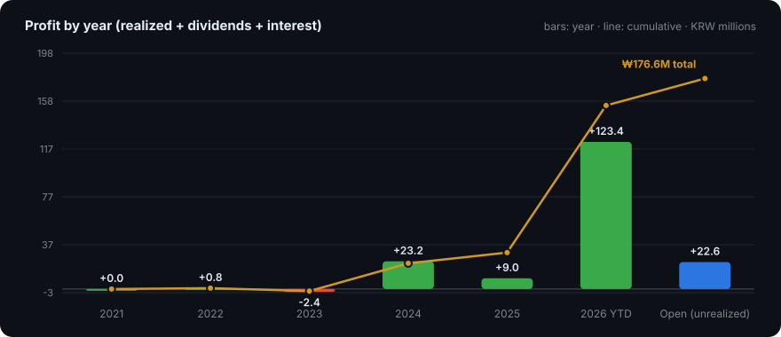

# 📈 Track Record

**Five years of real, broker-verified trades — ₩65.9M grew into ₩242.5M of value (3.68×) while ₩85M was taken out along the way.**

Kiwoom Securities · KRX / KOSDAQ cash equities · every number reconciles to the broker's own statements in <a href="statements/"><code>statements/</code></a>

[Summary](#-summary) · [By Year](#-by-year) · [By Stock](#-by-stock) · [Open Position](#-open-position) · [Data](#%EF%B8%8F-data) · [Method](#-method)

---

## 🎯 Summary

| | |
|---|---|
| **Starting capital** (Oct 2021) | ₩65.9M |
| **Withdrawn along the way** | ₩85.0M |
| **Ending equity** (cash ₩61.9M + positions ₩95.6M) | ₩157.5M |
| **Total profit** | **₩176.6M** |
| **Return on starting capital** | **268%** · 3.68× |
| **Money-weighted return (IRR)** | **32.1% per year** over 5.0 years |

| Where the profit came from | |
|---|---|
| Realized trading gains (after commissions &amp; tax) | ₩148.7M |
| Unrealized gain on the open position | ₩22.6M |
| Dividends (after withholding) | ₩4.9M |
| Interest on cash | ₩0.4M |
| Total traded | bought ₩321.7M · sold ₩398.2M · 13 buys / 28 sell fills |
| Costs | commissions ₩105,810 · transaction tax ₩760,074 · dividend tax ₩791,490 |

## 📅 By Year

| Year | Bought | Sold | Realized P&L | Dividends | Interest | Total profit | Withdrawn |
|---|---|---|---|---|---|---|---|
| 2021 | ₩22.1M | ₩0.0M | ₩0.0M | ₩0.0M | ₩0.0M | **₩0.0M** | ₩0.0M |
| 2022 | ₩18.2M | ₩0.0M | ₩0.0M | ₩0.7M | ₩0.1M | **₩0.8M** | ₩0.0M |
| 2023 | ₩43.3M | ₩15.9M | ₩-4.3M | ₩1.8M | ₩0.0M | **₩-2.4M** | ₩0.0M |
| 2024 | ₩22.2M | ₩72.4M | ₩22.8M | ₩0.4M | ₩0.0M | **₩23.2M** | ₩0.0M |
| 2025 | ₩47.1M | ₩43.7M | ₩7.6M | ₩1.3M | ₩0.2M | **₩9.0M** | ₩35.0M |
| 2026 (YTD) | ₩168.8M | ₩266.2M | ₩122.6M | ₩0.7M | ₩0.1M | **₩123.4M** | ₩50.0M |

> **2024–2026 is where the record was made:** a 310-share position in **HD Hyundai Heavy Industries** bought at ~₩140K in 2023 was scaled out between ₩208K and ₩655K, and **Samsung Electronics** was traded around a core position through its 2025–26 rally.

## 🏷️ By Stock

| Stock | Bought | Sold | Realized | Dividends | Unrealized | Total |
|---|---|---|---|---|---|---|
| 삼성전자 (A005930) | ₩144.3M | ₩153.7M | ₩82.1M | ₩1.5M | ₩22.6M | **₩106.1M** |
| HD현대중공업 (A329180) | ₩43.3M | ₩104.6M | ₩61.0M | ₩0.6M | ₩0.0M | **₩61.6M** |
| 고려아연 (A010130) | ₩40.3M | ₩43.0M | ₩2.7M | ₩2.9M | ₩0.0M | **₩5.6M** |
| 대한조선 (A439260) | ₩83.7M | ₩86.7M | ₩2.8M | ₩0.0M | ₩0.0M | **₩2.8M** |
| 노타 (A486990) | ₩10.1M | ₩10.2M | ₩0.1M | ₩0.0M | ₩0.0M | **₩0.1M** |

## 📌 Open Position

| Stock | Shares | Avg cost | Price (2026-10-12) | Market value | Unrealized |
|---|---|---|---|---|---|
| 삼성전자 (A005930) | 400 | ₩182,496 | ₩239,000 | ₩95.6M | **₩22.6M (+31.0%)** |

## 🗂️ Data

| Path | Contents |
|---|---|
| [`statements/`](statements/) | Original Kiwoom Securities 종합거래내역 statements, one PDF per year (Oct → Oct), 2021–2026 |
| [`data/Kiwoom_Transactions.xlsx`](data/Kiwoom_Transactions.xlsx) | Workbook — Summary · By Year · By Stock · Trades (with cost basis and P&amp;L) · Holdings · Cash Flows · All Transactions |
| [`data/transactions.csv`](data/transactions.csv) | Every one of the 82 statement lines, machine-readable |

## 🔍 Method

- **Source of truth.** All 82 statement lines were parsed from the broker PDFs; the running cash balance reconciles to the won on every line.
- **Realized P&amp;L** uses the average-cost method, net of commissions and securities-transaction tax. Multi-fill orders carry their costs on the final fill, as the broker books them.
- **Total profit** = ending equity + net withdrawals − starting capital, so it does not depend on the cost method. It equals realized + unrealized + dividends + interest.
- **IRR** is money-weighted, treating each withdrawal as a cash flow on its date.
- **Open position** is valued at the Yahoo Finance close on 2026-10-12; the unrealized figure moves with the market.
- **Scope.** One Kiwoom cash account, KRW equities only. Starting capital is the cash balance at the start of the first statement (no positions were held then). Past results do not guarantee future returns; nothing here is investment advice.

---

By <a href="https://github.com/HyeonbinJung">Hyeonbin Jung</a> · <a href="https://www.hyeonbin.dev">hyeonbin.dev</a>

