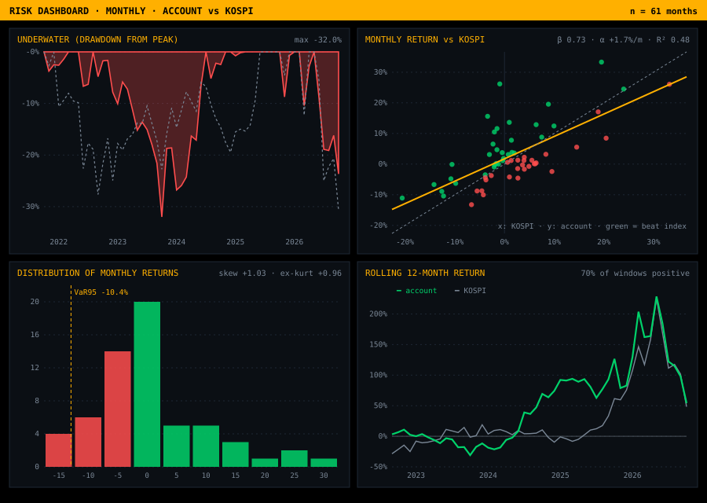

<p align="center"></p>

<p align="center">
<code>PERSONAL ACCOUNT</code> · <code>LONG-ONLY KOREAN EQUITIES</code> · <code>KIWOOM SECURITIES</code> · <code>KRW</code> · <code>OCT 2021 → OCT 2026</code> · <code>AUDITABLE: BROKER STATEMENTS ATTACHED</code>
</p>

# Track Record — Performance Tearsheet

> **₩65.9M ($49.3K) of starting capital compounded at 34.3% a year time-weighted (31.1% in USD) — 19.2 percentage points a year ahead of the KOSPI and 19.6 ahead of the S&amp;P 500 — creating ₩241.9M ($181.1K) of total value, a 3.67× multiple on invested capital, of which ₩85.0M ($63.6K) has already been withdrawn.** Every KRW figure below reconciles to the won against the broker's own statements in [`statements/`](statements/); USD figures are translated at ₩1,335.85 / $1 (USD/KRW close, 2026-10-12).

## I. Key Figures

| Capital | | Returns | |
|---|---:|---|---:|
| Initial capital · 14 Oct 2021 | **₩65.9M** | Total P&amp;L | **₩176.0M** |
| Distributions (withdrawals) | ₩85.0M | Time-weighted CAGR | **34.3%** |
| NAV · 12-OCT-2026 | **₩156.9M** | Money-weighted IRR | **32.1%** |
| ↳ cash / equities | ₩61.9M / ₩95.0M | KOSPI CAGR (same window) | 15.1% |
| Total value (NAV + distributions) | **₩241.9M** | MOIC · DPI | **3.67x** · 1.29x |

**USD view** — translated at **₩1,335.85 / $1**, the USD/KRW close on 2026-10-12 (Yahoo Finance `KRW=X`).

| Capital (USD) | | Returns (USD) | |
|---|---:|---|---:|
| Initial capital · 14 Oct 2021 | **$49.3K** | Total P&amp;L | **$131.7K** |
| Distributions (withdrawals) | $63.6K | USD time-weighted CAGR ¹ | **31.1%** |
| NAV · 12-OCT-2026 | **$117.4K** | USD cumulative TWR ¹ | +286% |
| ↳ cash / equities | $46.3K / $71.1K | KRW move vs USD, same window | -13.0% |
| Total value (NAV + distributions) | **$181.1K** | MOIC (FX-neutral) | **3.67x** |

<sub>¹ USD returns re-price each month at that month's USD/KRW close (₩1,182.13 on 14 Oct 2021 → ₩1,335.85 on 2026-10-12), so they include the currency effect. At the 2021 rate the initial capital was $55.7K. The single-rate table above is a translation only and does not include FX effects.</sub>

## II. Risk &amp; Return Statistics

```text
┌─ PERFORMANCE ──────────────────────────────┬─ RISK ─────────────────────────────────────┐
│ Time-weighted return (CAGR)          34.3% │ Annualized volatility                33.5% │
│ Money-weighted return (IRR)          32.1% │ Sharpe ratio (rf 3%)                  0.94 │
│ Cumulative TWR                       +336% │ Sortino ratio                         2.20 │
│ KOSPI cumulative, same window        +102% │ Max drawdown                        -32.0% │
│ Multiple on invested capital         3.67x │ Calmar ratio                          1.07 │
│ Jensen's alpha vs KOSPI             +22.4% │ Beta / correlation to KOSPI    0.73 / 0.69 │
│ Positive months                    36 / 61 │ Average equity exposure                74% │
└────────────────────────────────────────────┴────────────────────────────────────────────┘
```

```text
┌─ DISTRIBUTION ─────────────────────────────┬─ BENCHMARK-RELATIVE ───────────────────────┐
│ Mean monthly return                 +2.87% │ Tracking error                       25.6% │
│ Monthly volatility                   9.66% │ Information ratio                     0.75 │
│ Skewness                             +1.03 │ Upside capture                         72% │
│ Excess kurtosis                      +0.96 │ Downside capture                       26% │
│ VaR 95% (1M, historical)            -10.4% │ R-squared                             0.48 │
│ CVaR 95% (1M, historical)           -11.6% │ Treynor ratio                         0.43 │
│ Positive rolling-12M windows           70% │ Months beating KOSPI               33 / 61 │
└────────────────────────────────────────────┴────────────────────────────────────────────┘
```

<p align="center"></p>

<sub>Monthly Modified-Dietz returns on month-end NAV (cash + positions at Yahoo Finance closes), geometrically linked. Risk-free rate 3% p.a. Max drawdown trough: 2023-10. Best month 2026-02 (+33.3%), worst 2023-10 (-13.2%).</sub>

## III. Benchmark Comparison

**KRW basis** — what a Korean investor earned holding each index unhedged (US indices converted at monthly USD/KRW closes).

| | CAGR | Cumulative | Volatility | Sharpe | Max DD | Account excess p.a. | Account β | Account α | Months beaten |
|---|---:|---:|---:|---:|---:|---:|---:|---:|---:|
| **Account** | **34.3%** | **+336%** | 33.5% | **0.94** | -32.0% | — | — | — | — |
| KOSPI <sub>`^KS11`</sub> | 15.1% | +102% | 31.8% | 0.38 | -30.6% | **+19.2%** | 0.73 | +22.4% | 33 / 61 |
| KOSDAQ <sub>`^KQ11`</sub> | -3.4% | -16% | 28.9% | -0.22 | -39.7% | **+37.7%** | 0.42 | +34.0% | 33 / 61 |
| S&P 500 <sub>`^GSPC`</sub> | 14.8% | +99% | 13.9% | 0.84 | -14.7% | **+19.6%** | 0.67 | +23.4% | 30 / 61 |
| Nasdaq-100 <sub>`^NDX`</sub> | 18.2% | +130% | 19.3% | 0.79 | -29.0% | **+16.1%** | 0.46 | +24.3% | 29 / 61 |
| Dow Jones <sub>`^DJI`</sub> | 10.9% | +68% | 13.6% | 0.58 | -14.7% | **+23.4%** | 0.65 | +26.2% | 32 / 61 |

**USD basis** — the account translated into dollars each month against each index in dollars.

| | CAGR | Cumulative | Volatility | Sharpe | Max DD | Account excess p.a. | Account β | Account α | Months beaten |
|---|---:|---:|---:|---:|---:|---:|---:|---:|---:|
| **Account** | **31.1%** | **+286%** | 35.0% | **0.80** | -35.9% | — | — | — | — |
| KOSPI <sub>`^KS11`</sub> | 12.4% | +79% | 35.1% | 0.27 | -40.9% | **+18.7%** | 0.73 | +21.2% | 33 / 61 |
| KOSDAQ <sub>`^KQ11`</sub> | -5.8% | -26% | 33.4% | -0.26 | -46.8% | **+36.8%** | 0.49 | +32.3% | 33 / 61 |
| S&P 500 <sub>`^GSPC`</sub> | 12.0% | +76% | 15.3% | 0.59 | -24.8% | **+19.1%** | 0.88 | +20.1% | 30 / 61 |
| Nasdaq-100 <sub>`^NDX`</sub> | 15.3% | +104% | 20.5% | 0.60 | -33.0% | **+15.7%** | 0.60 | +20.7% | 29 / 61 |
| Dow Jones <sub>`^DJI`</sub> | 8.2% | +49% | 14.7% | 0.36 | -20.9% | **+22.8%** | 0.90 | +23.3% | 32 / 61 |

<sub>Price indices (no dividends) from Yahoo Finance over the account's monthly window. Excess = account CAGR − index CAGR; β, Jensen's α (rf 3%) and months beaten come from the account's monthly returns against each index.</sub>

## IV. Calendar-Year Performance

| Year | Account (TWR) | KOSPI | Active return | Realized P&amp;L | Dividends + interest | Turnover |
|---|---:|---:|---:|---:|---:|---:|
| **2021** | -2.5% | -1.2% | **-1.3%** | ₩0.0M | ₩0.0M | ₩22.1M |
| **2022** | +2.5% | -24.9% | **+27.4%** | ₩0.0M | ₩0.8M | ₩18.2M |
| **2023** | -11.7% | +18.7% | **-30.4%** | -₩4.3M | ₩1.8M | ₩59.2M |
| **2024** | +74.3% | -9.6% | **+83.9%** | ₩22.8M | ₩0.5M | ₩94.6M |
| **2025** | +82.7% | +75.6% | **+7.1%** | ₩7.6M | ₩1.5M | ₩90.8M |
| **2026** YTD | +55.2% | +44.6% | **+10.7%** | ₩122.6M | ₩0.8M | ₩435.0M |

<p align="center"></p>

## V. P&amp;L Attribution by Position

| Position | Ticker | Realized | Dividends | Unrealized | Total P&amp;L | Share of P&amp;L |
|---|---|---:|---:|---:|---:|---:|
| Samsung Electronics | `005930 KS` | ₩82.1M | ₩1.5M | ₩22.0M | **₩105.5M** | 60.1% |
| HD Hyundai Heavy Industries | `329180 KS` | ₩61.0M | ₩0.6M | ₩0.0M | **₩61.6M** | 35.1% |
| Korea Zinc | `010130 KS` | ₩2.7M | ₩2.9M | ₩0.0M | **₩5.6M** | 3.2% |
| Daehan Shipbuilding | `439260 KS` | ₩2.8M | ₩0.0M | ₩0.0M | **₩2.8M** | 1.6% |
| Nota | `486990 KQ` | ₩0.1M | ₩0.0M | ₩0.0M | **₩0.1M** | 0.0% |
| **Total** | | **₩148.7M** | **₩4.9M** | **₩22.0M** | **₩175.6M** | 100% |

<sub>Plus ₩0.4M of interest on idle cash. Realized P&amp;L uses average cost, net of commissions and transaction tax.</sub>

## VI. Trading &amp; Execution

```text
┌─ TRADING ──────────────────────────────────┬─ EXECUTION ────────────────────────────────┐
│ Closed sell orders                      23 │ Gross turnover                     ₩719.9M │
│ Winners / losers                    20 / 3 │ Commissions                       ₩105,810 │
│ Hit rate                               87% │ Securities transaction tax        ₩760,074 │
│ Profit factor                        12.6x │ All-in cost / turnover             12.0 bp │
│ Average winner                       ₩8.1M │ Dividend withholding              ₩791,490 │
│ Average loser                       -₩4.3M │ Buy orders / sell fills            13 / 28 │
└────────────────────────────────────────────┴────────────────────────────────────────────┘
```

| Notable trades | Date | Position | P&amp;L | Return on cost |
|---|---|---|---:|---:|
| Largest gain | 2026-01-26 | HD Hyundai Heavy Industries | **₩23.5M** | +337% |
| Largest loss | 2026-06-05 | Daehan Shipbuilding | -₩8.4M | -18% |

> **The defining trade.** 310 shares of **HD Hyundai Heavy Industries** bought at **₩139,800** in July 2023 and scaled out in eight tranches between **₩208,000** and **₩655,000** — ₩61.0M realized on a ₩43.3M position.

## VII. Current Exposure · 12-OCT-2026

| Position | Ticker | Shares | Avg cost | Last | Market value | % of NAV | Unrealized |
|---|---|---:|---:|---:|---:|---:|---:|
| Samsung Electronics | `005930 KS` | 400 | ₩182,496 | ₩237,500 | ₩95.0M | 61% | **₩22.0M (+30.1%)** |
| Cash (KRW) | | | | | ₩61.9M | 39% | |

## VIII. Data Room

| File | Description |
|---|---|
| [`statements/`](statements/) | Kiwoom Securities 종합거래내역 — five annual statements (Korean originals), Oct 2021 → Oct 2026 |
| [`statements (EN)/`](<statements%20(EN)/>) | English translations of the same statements — identical pages and figures, labels translated in place |
| [`data/Kiwoom_Transactions.xlsx`](data/Kiwoom_Transactions.xlsx) | Workbook · Summary · By Year · By Stock · Trades with cost basis · Holdings · Cash Flows · Monthly NAV · All Transactions |
| [`data/transactions.csv`](data/transactions.csv) | All 82 statement lines, machine-readable |
| [`data/monthly_nav.csv`](data/monthly_nav.csv) | Month-end cash, positions, NAV, flows, TWR and KOSPI series |

## IX. Methodology &amp; Disclosures

- **Reconciliation.** All 82 broker lines were parsed; the running cash balance matches the statement on every line.
- **NAV.** Month-end cash plus positions marked at Yahoo Finance closing prices (fills reconcile to closes within ±5%).
- **Returns.** TWR links monthly Modified-Dietz returns, neutralizing withdrawals; IRR is money-weighted with each withdrawal dated. MOIC = (NAV + distributions) / initial capital; DPI = distributions / initial capital.
- **Benchmark.** KOSPI price index (^KS11), not total return. Alpha is Jensen's alpha from monthly returns.
- **Currency.** USD figures use USD/KRW closes from Yahoo Finance (`KRW=X`); see the note under the USD table.

**Formulas**

$$r_t=\frac{V_t-V_{t-1}-F_t}{V_{t-1}+w_tF_t},\qquad \text{TWR}=\prod_{t=1}^{T}(1+r_t)-1,\qquad \text{CAGR}=(1+\text{TWR})^{1/Y}-1$$

$$\sum_{k}\frac{CF_k}{(1+\text{IRR})^{\tau_k}}=0,\qquad \text{MOIC}=\frac{\text{NAV}_T+\sum \text{Dist}}{C_0},\qquad \text{DPI}=\frac{\sum \text{Dist}}{C_0}$$

$$\text{Sharpe}=\frac{\text{CAGR}-r_f}{\sigma\sqrt{12}},\qquad \alpha_J=\text{CAGR}-\big[r_f+\beta(\text{CAGR}_{\text{KOSPI}}-r_f)\big],\qquad \text{IR}=\frac{\text{CAGR}-\text{CAGR}_{\text{KOSPI}}}{\sigma(r-r_{\text{KOSPI}})\sqrt{12}}$$

<sub>V = month-end NAV, F = net external flow (withdrawals negative) weighted by w, the share of the month remaining after the flow; Y = years; σ = monthly standard deviation.</sub>

**Reproduce**

```python
import pandas as pd
nav = pd.read_csv("data/monthly_nav.csv", parse_dates=["month_end"])
r, b = nav["twr_month"], nav["kospi_month"]
years = (nav["month_end"].iloc[-1] - pd.Timestamp("2021-10-14")).days / 365.25
cagr = (1 + r).prod() ** (1 / years) - 1                      # ≈ 34.3%
sharpe = (cagr - 0.03) / (r.std() * 12 ** 0.5)                # ≈ 0.94
beta = r.cov(b) / b.var()                                    # ≈ 0.73
max_dd = (nav["twr_index"] / nav["twr_index"].cummax() - 1).min()  # ≈ -32.0%
```
- **Scope.** One cash account; long-only KRW listed equities; no leverage, shorting or derivatives. The account held no positions at the first statement date.

> [!NOTE]
> Personal-account results, shown for transparency. Past performance does not guarantee future returns, and nothing here is investment advice.

<p align="right"><sub>Hyeonbin Jung · <a href="https://www.hyeonbin.dev">hyeonbin.dev</a> · <a href="https://github.com/HyeonbinJung">GitHub</a></sub></p>
