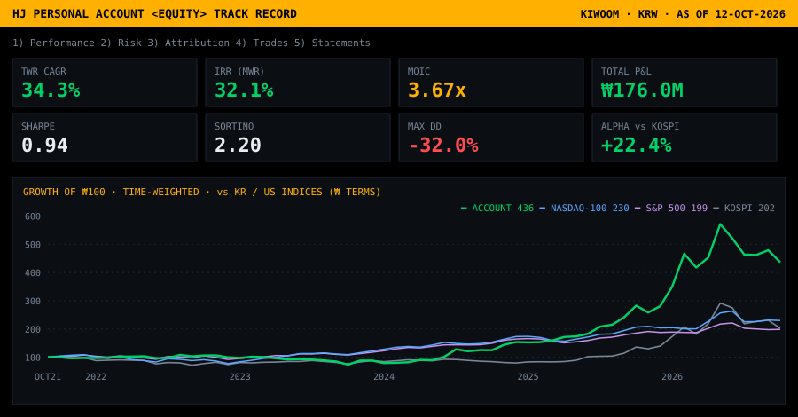
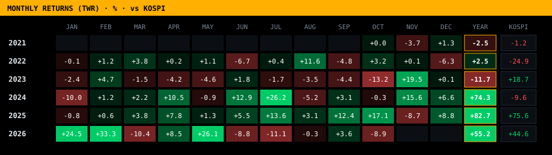

<p align="center"></p>

<p align="center">
<code>PERSONAL ACCOUNT</code> · <code>LONG-ONLY KOREAN EQUITIES</code> · <code>KIWOOM SECURITIES</code> · <code>KRW</code> · <code>OCT 2021 → OCT 2026</code> · <code>AUDITABLE: BROKER STATEMENTS ATTACHED</code>
</p>

# Track Record — Performance Tearsheet

> **₩65.9M of starting capital compounded at 34.3% a year (time-weighted) — 19.2% a year ahead of the KOSPI — and turned into ₩241.9M of total value (3.67× MOIC) while ₩85.0M was distributed back out.** Every figure below reconciles to the won against the broker's own statements in [`statements/`](statements/).

## I. Key Figures

| Capital | | Returns | |
|---|---:|---|---:|
| Initial capital · 14 Oct 2021 | **₩65.9M** | Total P&amp;L | **₩176.0M** |
| Distributions (withdrawals) | ₩85.0M | Time-weighted CAGR | **34.3%** |
| NAV · 12-OCT-2026 | **₩156.9M** | Money-weighted IRR | **32.1%** |
| ↳ cash / equities | ₩61.9M / ₩95.0M | KOSPI CAGR (same window) | 15.1% |
| Total value (NAV + distributions) | **₩241.9M** | MOIC · DPI | **3.67x** · 1.29x |

## II. Risk &amp; Return Statistics

```text
┌─ PERFORMANCE ──────────────────────────────┬─ RISK ─────────────────────────────────────┐
│ Time-weighted return (CAGR)          34.3% │ Annualized volatility                33.5% │
│ Money-weighted return (IRR)          32.1% │ Sharpe ratio (rf 3%)                  0.94 │
│ Cumulative TWR                       +336% │ Sortino ratio                         2.20 │
│ KOSPI cumulative, same window        +102% │ Max drawdown                        -32.0% │
│ Multiple on invested capital         3.67x │ Calmar ratio                          1.07 │
│ Jensen's alpha vs KOSPI             +22.4% │ Beta / correlation to KOSPI    0.73 / 0.69 │
│ Positive months                    36 / 61 │ Average equity exposure                74% │
└────────────────────────────────────────────┴────────────────────────────────────────────┘
```

<sub>Monthly Modified-Dietz returns on month-end NAV (cash + positions at Yahoo Finance closes), geometrically linked. Risk-free rate 3% p.a. Max drawdown trough: 2023-10. Best month 2026-02 (+33.3%), worst 2023-10 (-13.2%).</sub>

## III. Calendar-Year Performance

| Year | Account (TWR) | KOSPI | Active return | Realized P&amp;L | Dividends + interest | Turnover |
|---|---:|---:|---:|---:|---:|---:|
| **2021** | -2.5% | -1.2% | **-1.3%** | ₩0.0M | ₩0.0M | ₩22.1M |
| **2022** | +2.5% | -24.9% | **+27.4%** | ₩0.0M | ₩0.8M | ₩18.2M |
| **2023** | -11.7% | +18.7% | **-30.4%** | -₩4.3M | ₩1.8M | ₩59.2M |
| **2024** | +74.3% | -9.6% | **+83.9%** | ₩22.8M | ₩0.5M | ₩94.6M |
| **2025** | +82.7% | +75.6% | **+7.1%** | ₩7.6M | ₩1.5M | ₩90.8M |
| **2026** YTD | +55.2% | +44.6% | **+10.7%** | ₩122.6M | ₩0.8M | ₩435.0M |

<p align="center"></p>

## IV. P&amp;L Attribution by Position

| Position | Ticker | Realized | Dividends | Unrealized | Total P&amp;L | Share of P&amp;L |
|---|---|---:|---:|---:|---:|---:|
| Samsung Electronics | `005930 KS` | ₩82.1M | ₩1.5M | ₩22.0M | **₩105.5M** | 60.1% |
| HD Hyundai Heavy Industries | `329180 KS` | ₩61.0M | ₩0.6M | ₩0.0M | **₩61.6M** | 35.1% |
| Korea Zinc | `010130 KS` | ₩2.7M | ₩2.9M | ₩0.0M | **₩5.6M** | 3.2% |
| Daehan Shipbuilding | `439260 KS` | ₩2.8M | ₩0.0M | ₩0.0M | **₩2.8M** | 1.6% |
| Nota | `486990 KQ` | ₩0.1M | ₩0.0M | ₩0.0M | **₩0.1M** | 0.0% |
| **Total** | | **₩148.7M** | **₩4.9M** | **₩22.0M** | **₩175.6M** | 100% |

<sub>Plus ₩0.4M of interest on idle cash. Realized P&amp;L uses average cost, net of commissions and transaction tax.</sub>

## V. Trading &amp; Execution

```text
┌─ TRADING ──────────────────────────────────┬─ EXECUTION ────────────────────────────────┐
│ Closed sell orders                      23 │ Gross turnover                     ₩719.9M │
│ Winners / losers                    20 / 3 │ Commissions                       ₩105,810 │
│ Hit rate                               87% │ Securities transaction tax        ₩760,074 │
│ Profit factor                        12.6x │ All-in cost / turnover             12.0 bp │
│ Average winner                       ₩8.1M │ Dividend withholding              ₩791,490 │
│ Average loser                       -₩4.3M │ Buy orders / sell fills            13 / 28 │
└────────────────────────────────────────────┴────────────────────────────────────────────┘
```

| Notable trades | Date | Position | P&amp;L | Return on cost |
|---|---|---|---:|---:|
| Largest gain | 2026-01-26 | HD Hyundai Heavy Industries | **₩23.5M** | +337% |
| Largest loss | 2026-06-05 | Daehan Shipbuilding | -₩8.4M | -18% |

> **The defining trade.** 310 shares of **HD Hyundai Heavy Industries** bought at **₩139,800** in July 2023 and scaled out in eight tranches between **₩208,000** and **₩655,000** — ₩61.0M realized on a ₩43.3M position.

## VI. Current Exposure · 12-OCT-2026

| Position | Ticker | Shares | Avg cost | Last | Market value | % of NAV | Unrealized |
|---|---|---:|---:|---:|---:|---:|---:|
| Samsung Electronics | `005930 KS` | 400 | ₩182,496 | ₩237,500 | ₩95.0M | 61% | **₩22.0M (+30.1%)** |
| Cash (KRW) | | | | | ₩61.9M | 39% | |

## VII. Data Room

| File | Description |
|---|---|
| [`statements/`](statements/) | Kiwoom Securities 종합거래내역 — five annual statements, Oct 2021 → Oct 2026 |
| [`data/Kiwoom_Transactions.xlsx`](data/Kiwoom_Transactions.xlsx) | Workbook · Summary · By Year · By Stock · Trades with cost basis · Holdings · Cash Flows · Monthly NAV · All Transactions |
| [`data/transactions.csv`](data/transactions.csv) | All 82 statement lines, machine-readable |
| [`data/monthly_nav.csv`](data/monthly_nav.csv) | Month-end cash, positions, NAV, flows, TWR and KOSPI series |

## VIII. Methodology &amp; Disclosures

- **Reconciliation.** All 82 broker lines were parsed; the running cash balance matches the statement on every line.
- **NAV.** Month-end cash plus positions marked at Yahoo Finance closing prices (fills reconcile to closes within ±5%).
- **Returns.** TWR links monthly Modified-Dietz returns, neutralizing withdrawals; IRR is money-weighted with each withdrawal dated. MOIC = (NAV + distributions) / initial capital; DPI = distributions / initial capital.
- **Benchmark.** KOSPI price index (^KS11), not total return. Alpha is Jensen's alpha from monthly returns.
- **Scope.** One cash account; long-only KRW listed equities; no leverage, shorting or derivatives. The account held no positions at the first statement date.

> [!NOTE]
> Personal-account results, shown for transparency. Past performance does not guarantee future returns, and nothing here is investment advice.

<p align="right"><sub>Hyeonbin Jung · <a href="https://www.hyeonbin.dev">hyeonbin.dev</a> · <a href="https://github.com/HyeonbinJung">GitHub</a></sub></p>
